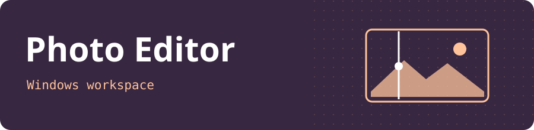

[English](README.md) · **Українська**

[](https://github.com/kycile24/photo-editor/releases/latest/download/PhotoEditor-win-x64.zip)

Настільний редактор для локальної обробки фотографій. Відкрий серію знімків, скоригуй колір і кадрування та порівняй результат з оригіналом перед експортом.

**[Завантажити для Windows x64](https://github.com/kycile24/photo-editor/releases/latest/download/PhotoEditor-win-x64.zip)** · [Історія випусків](https://github.com/kycile24/photo-editor/releases)

Розпакуй ZIP і відкрий **PhotoEditor.exe**. Середовище .NET 10 уже входить до збірки. Мову можна змінити кнопками **EN** і **УКР** на панелі інструментів.


## Від оригіналу до готового зображення

1. Перетягни фото у вікно або натисни **Ctrl+O**. Для першої спроби є [приклад фотографії](examples/preview.jpg).
2. Відкрий налаштування балансу кольорів і яскравості та зміни положення повзунків.
3. Увімкни порівняння з оригіналом і пересунь роздільник. **F11** відкриває повноекранний режим, **Esc** повертає попередній вигляд.
4. Натисни **Ctrl+Shift+S**, щоб зберегти результат в окремий PNG.

Редактор також підтримує пакетну зміну розміру й формату, кадрування, поділ зображень на частини, водяні знаки, об’єднання знімків, гістограми яскравості й порівняння фільтрів шуму з експортом у CSV.

## Розробка

Інтерфейс Windows Forms міститься в `src/PhotoEditor/UI`, а перетворення пікселів, фільтри й метрики — у `src/PhotoEditor/Imaging`. Для запуску з коду на Windows встанови .NET 10 SDK і виконай:

```powershell
dotnet run --project src/PhotoEditor/PhotoEditor.csproj
```

GitHub Actions перевіряє робоче вікно редактора, збирає автономний пакет x64 та публікує версійні випуски.
